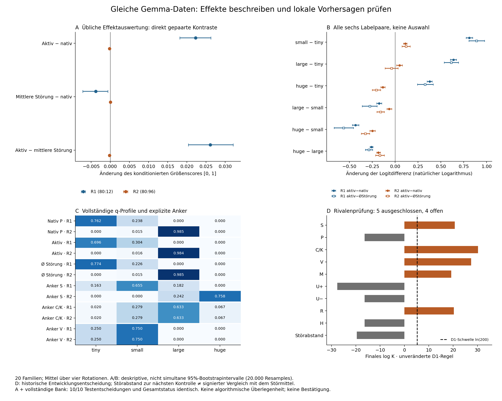
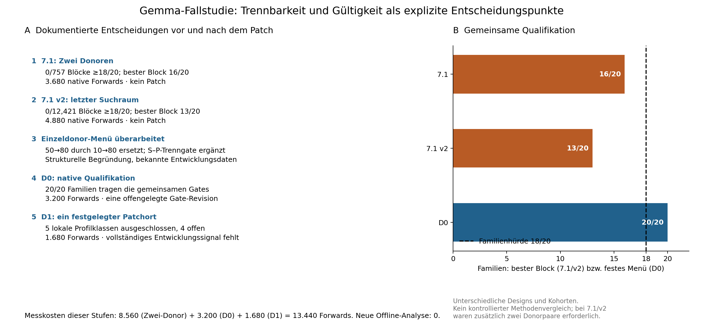

# Gemma: Patchauswertung und explizite Rivalenprüfung auf denselben Daten

**Der zusätzliche Nutzen ist hier eine explizite, begrenzte Aussage über lokale Vorhersagen. Eine Überlegenheit gegenüber sorgfältiger Patchauswertung wurde nicht gezeigt.** Die übliche Auswertung erkennt kleine Änderungen und einen deskriptiven Unterschied zum Störmittel. Die Rivalenbank ergänzt fünf deklarierte Ausschlüsse und vier offene Klassen. Mit derselben Bank und derselben Regel reproduziert die einfache Gegenrechnung alle zehn Entscheidungen: ein klarer Gleichstand.

Status: **post hoc, explorativ, Entwicklung**. Alle D1-Ergebnisse waren vor der Planung bekannt. 0 neue Modell-Forwards; D1, historische Daten und fremde Dateien unverändert. Das [Protokoll](PROTOCOL.md) erläutert die Informationsbedingung, Metriken und Literaturgrundlage. Die [Aussagentabelle](CLAIMS.md) trennt zusätzliche Information, Gleichstände und unzulässige Schlüsse.

## Was die sorgfältige Patchauswertung tatsächlich findet

Ein Ort nach Textblock 17 (Index 16), letzte Promptposition, voller Residualvektor. Donor Standard 10/Wert 32 cm; Empfänger R1 Standard 80/Wert 12 cm und R2 Standard 80/Wert 96 cm. Gemma-3-4b-it, Revision `093f9f388b31de276ce2de164bdc2081324b9767`. Alle 20 Familien und vier Rotationen bleiben erhalten.

| Gepaarter Kontrast | R1: Mittel [deskriptives 95%-Intervall] | R2: Mittel [deskriptives 95%-Intervall] |
|---|---:|---:|
| Aktiv − nativ | +0.022276 [+0.018153; +0.026260] | -0.000213 [-0.000348; -0.000100] |
| Mittlere Störung − nativ | -0.003817 [-0.007187; -0.000677] | +0.000016 [-0.000102; +0.000135] |
| Aktiv − mittlere Störung | +0.026093 [+0.020364; +0.032060] | -0.000229 [-0.000437; -0.000063] |

Score: 0=tiny, 1/3=small, 2/3=large, 1=huge. Die Intervalle verwenden 20.000 gemeinsame Familienresamples, Seed 20261015. Sie sind **approximativ und nicht simultan**; Rotationen, Empfänger und Störungen erhöhen n nicht. Keine neue bestätigende Testentscheidung wird daraus abgeleitet.

Beim ersten Empfänger verschiebt der aktive Patch rund 6,68 Prozentpunkte konditionierte Wahrscheinlichkeit von tiny zu small (ordinal +0,02228). Beim zweiten ist die ordinal negative Änderung viel kleiner. Der Kontrast aktiv minus Störmittel liegt bei beiden Empfängern deskriptiv abseits null. Beim ersten gilt dies auch gegenüber jeder der vier einzelnen Störungen. Beim zweiten überlappen drei der vier Einzelkontrastintervalle null. Das wird nicht als Äquivalenz gewertet.

Die Aussage „Der Austausch verändert nichts“ ist damit zu stark. Auch „von Störungen nicht unterscheidbar“ wäre ohne Angabe der Messgröße zu pauschal. **Eine sorgfältige Standardauswertung sieht diese Information bereits.** Sie ist kein falscher positiver Mechanismenbefund: der Fehlschluss entstünde erst, wenn man aus der kleinen Verschiebung eine spezifische semantische Erklärung ableitete.

Alle sechs Label-Logitdifferenzen sind enthalten, nicht nur ein günstiges Paar. Beim direkten Vergleich mit dem Störmittel haben sie unterschiedliche Richtungen. Große Logitänderungen zwischen sehr seltenen Labels können zugleich kleine Änderungen des konditionierten Profils bedeuten; deshalb stehen Logitmetriken und vollständiges q nebeneinander. Sämtliche **176** Metrik-/Kontrast-/Empfängerzeilen einschließlich aller vier Störungen finden sich in [metric_summary.csv](metric_summary.csv); alle Familienwerte in [family_metrics.csv](family_metrics.csv).



*Abbildung 2:* A/B zeigen die sorgfältige Effektbeschreibung. C ergänzt vollständige Profilmittel und die expliziten nativen Anker; Zahlen auf drei Dezimalstellen gerundet, 0,000 bedeutet nicht exakt null. Die Auswertung benutzt ungerundete Daten. D zeigt die unveränderten D1-Entscheidungen. [PDF](figure_2_effects_and_rivals.pdf), [SVG](figure_2_effects_and_rivals.svg).

## Welche zusätzliche Aussage die Rivalenprüfung erlaubt

Die ergänzende Frage lautet: **Welche im Voraus konkretisierten Veränderungen wären bei Standardtransfer, Kopie, Werttransfer und den übrigen Klassen zu erwarten, und widerspricht das gemessene Profil diesen lokalen Vorhersagen?** Ein einzelner Effektwert beantwortet dies nicht vollständig. Eine vollständige Profilansicht erlaubt aber bereits qualitative Widersprüche zu großen erwarteten Transfer-/Kopieeffekten; diese Einsicht gehört nicht exklusiv B.

| Klasse / Kontrolle | Mittlerer Profilverlust | Finales log K | Originale D1-Entscheidung | A+Bank vs. B |
|---|---:|---:|---|---|
| S | 0.291411 | 20.719826 | ausgeschlossen | Gleichstand |
| P | 0.022276 | -16.371065 | offen | Gleichstand |
| C_K | 0.480994 | 30.282466 | ausgeschlossen | Gleichstand |
| V | 0.411150 | 27.456013 | ausgeschlossen | Gleichstand |
| M | 0.268998 | 19.240930 | ausgeschlossen | Gleichstand |
| U_plus | 0.000213 | -27.613266 | offen | Gleichstand |
| U_minus | 0.022276 | -16.371065 | offen | Gleichstand |
| R | 0.279936 | 20.341185 | ausgeschlossen | Gleichstand |
| H | 0.022275 | -16.371288 | offen | Gleichstand |
| noise | 0.015196 | -19.599978 | Abstandstest nicht bestanden | Gleichstand |

S=Standardtransfer; P=unveränderter Empfänger; C/K=Donorantwortkopie bzw. gesamter Donorkontext; V=Donorwert bei Empfängerstandard; M=Mischung S–C/K; U±=allgemeine stochastische Größer-/Kleinerverschiebung; R=gemeinsames empfängerunabhängiges Profil; H=Schrumpfung zum mittleren Empfängerprofil. M/H werden über konservative Familienhüllen globaler Parameterklassen geprüft. Das ist keine nachträgliche Wahl unabhängiger Parameter pro Familie.

W1 benutzt Labelabstände von 1/3; pro Familie zählt das Maximum über beide Empfänger. Die ursprüngliche Regel verlangt mehr als einen von null verschiedenen Effekt: τ=1/12, ν=0,0001, X=max(0,L−ν), finales Produkt Π(1/4+9X), Schwelle 200 mit numerischer Sicherheitsmarge; schwache Familien würden X=0 beitragen. Alle 20 Familien sind gemeinsam qualifiziert. Die ursprüngliche Fehlerfamilie und Entwicklungsgrenze werden nicht erweitert.

Der Störtest benutzt pro Familie die **nächstgelegene von vier Störungen**, gemessen über den maximalen Empfänger-W1-Abstand. Er prüft eine toleranzgebundene Distanz, keine Gleichheit mit dem durchschnittlichen signierten Störeffekt. Sein Scheitern widerspricht daher nicht den kleinen signierten Differenzen oben. Ebenso ist P trotz kleiner messbarer Verschiebung unter dieser Regel offen. Nichtablehnung bestätigt weder P noch U± oder H.

**D1 bleibt `LIMITED_EXCLUSION_NO_CONFIRMED_EFFECT`.** Fünf deklarierte Profilklassen sind ausgeschlossen; P bleibt offen und der registrierte Störtest besteht nicht. Das geforderte vollständige Entwicklungssignal und die semantische Unterkonstellation fehlen. S ist hier sogar ausgeschlossen, statt als einzig verbleibende Erklärung gestützt zu werden. Kein Gewinner, keine Phase C, keine natürliche Nutzung, Notwendigkeit oder vollständige Vermittlung nachgewiesen.

## Der Gleichstand erklärt, wo der Beitrag liegt

A+Bank berechnet die neun Hüllen aus Roh-q und D0-Ankern ohne Producer-Importe erneut. Maximale Verlustabweichung zu D1: 1.67e-16. Alle zehn Entscheidungen und der gesamte Status stimmen überein. Die Bank und Entscheidungsregel sind dabei bewusst gleich: dies ist eine unabhängige Implementierung derselben Rechnung, **kein Test zweier verschiedener Inferenzverfahren**.

Damit ist der behauptbare Beitrag hier das explizite Formulieren und Qualifizieren der Alternativen sowie die nachvollziehbare Grenze der Entscheidung. **Eine bessere Entscheidungsarithmetik ist nicht belegt.** A ohne Bank beantwortet eine andere Frage; nicht spezifizierte Rivalen werden nicht als Fehler oder übersehene Wahrheit gezählt. Kein bekannter wahrer Gemma-Mechanismus steht für einen Vergleich von Trefferraten zur Verfügung. Die Zahl ausgeschlossener Klassen ist allein kein Erfolgsmaß.

## Was vor dem Patch sichtbar wurde



*Abbildung 1:* Dokumentierte Entscheidungen und Messkosten, kein hypothetisches Versagen eines Vergleichsforschers. [PDF](figure_1_design_history.pdf), [SVG](figure_1_design_history.svg).

Die Zwei-Donor-Prüfungen fanden 0/757 bzw. 0/12.421 Blöcke mit mindestens 18/20 gemeinsam qualifizierten Familien. Es fehlte die gemeinsame Erfüllung der Trenn- und Readoutbedingungen, nicht grundsätzlich jede Möglichkeit eines Zwei-Donor-Experiments. Die native Messung kostete 3.680 + 4.880 Forwards. Beide geplanten Patchschritte unterblieben.

Für das Einzeldonor-Menü wurde 50→80 durch 10→80 ersetzt und S–P-Trennung ausdrücklich gefordert. Diese Geschichte nutzt bekannte Entwicklungsdaten. Danach wurde **eine dateninformierte D0-Gate-Revision** offengelegt: die absolute Pro-Kurve-Umkehrgrenze entfiel; mindestens 31/34 nicht umgekehrte Nachbarschritte und keine Umkehr zwischen den benötigten Ankern blieben verpflichtend. D0 bestand dann auf frischen Entwicklungsfamilien 20/20; die Regeln waren vor D0/D1 eingefroren, aber nicht von Anfang an datenunabhängig gewählt. Die Kosten der in der Abbildung gezeigten Stufen betragen 13.440 Forwards; frühere andere Studien sind darin nicht enthalten.

Die Überprüfung macht die Frage ausführbar, ob ein Design die interessierende Unterscheidung überhaupt trägt. **Sie zeigt nicht, dass übliche sorgfältige Methoden solche Überlegungen niemals anstellen**, und belegt keine Wochenersparnis oder Planerüberlegenheit. Ein Vergleichsverfahren mit demselben Preflight kann denselben Stopp erreichen.

Strukturelles Beispiel, nicht neue Messung: Haben Donor und Empfänger denselben Wert und stimmt der sonstige Kontext überein, ist der native Standardtransferanker derselbe Prompt wie der Donor. S und C/K liefern dann identische Vorhersagen. Ein erfolgreicher Recovery-Wert kann diese beiden Erklärungen nicht trennen. Das tatsächliche D1-Menü nutzt verschiedene Werte; das Beispiel wird nicht als gemessener D1-Alias ausgegeben.

Historische Auditgrenze: Der ursprüngliche 7.1-v2-Replay gegen den während des Laufs fremd veränderten Kern-HEAD blieb formal `BLOCKED`. Der zusätzliche Replay gegen die gebundenen Dateien und die unabhängige Nachrechnung bestanden. Dieser Vorbehalt bleibt erhalten; D1s eigener Replay und unabhängiger Audit bestanden.

## Messvalidität getrennt berichten

D1s technische Kontrollen sind bestanden; die q-Folgen von No-op, Self, Entfernung und finaler Positivkontrolle stimmen in dieser Nachrechnung exakt mit den jeweiligen nativen Referenzen überein. Vollvokabellogits, Tensorauswechslung und Dosis-/Normfehler wurden **im historischen unabhängigen D1-Audit** geprüft; dieser Offline-Vergleich wiederholt keine 9-GB-Tensorprüfung.

Die oft zitierte ältere Zahl 0,04 % bezeichnet genauer **0,0432728775 % mittlere Labelmasse bei acht historischen Sentineltexten** im BOS-Diagnoselauf. Sie ist kein Median des gesamten alten Repos. Die Diagnose urteilte „BOS erklärt es nicht oder nur teilweise“ und blieb qualifikatorisch blockiert. Niedrige Labelmasse allein beweist weder zufällige Messwerte noch, dass BOS die einzige Ursache war. Das ist ein eigener Validitätsfall, kein konstruierter Fehler der Vergleichsmethode.

## Nachvollziehbarkeit und Grenzen

- [provenance.json](provenance.json): Quell-SHA-256, Repositoryzustand, Python/NumPy/Matplotlib, Skript- und Protokollhash. Alle 18 direkt verwendeten Quellartefakte wurden vor und nach der Analyse gehasht und blieben bytegleich. D0 und D1 sind an ihre historischen erfolgreichen Replay-/Auditdateien gebunden.
- 1.680 Records vollständig und eindeutig; Roh-q/Masse neu rekonstruiert, maximaler q-Fehler 2.22e-16; keine Familie verworfen. Die originalen Replay-/Auditbindungen wurden gegen die gelesenen Dateien geprüft.
- [results.json](results.json), [rival_comparison.csv](rival_comparison.csv), [family_profiles.csv](family_profiles.csv), [claims.csv](claims.csv) und [CLAIMS.md](CLAIMS.md) tragen die Zahlen und Aussagen.
- 10 gezielte CPU-Tests prüfen Transport, Hüllen gegen ein dichtes Kontrollgitter, stochastische Richtung, Paarung, Reproduzierbarkeit, fehlende/ungültige Werte und schwache Familien. Keine Tests übersprungen.
- Der erste Testaufruf direkt über die venv scheiterte am lokalen Importpfad (`numpy` nicht sichtbar). Der vorhandene `scripts/python_model.sh`-Wrapper repariert macOS-Hidden-Flags der .pth-Dateien; damit bestanden die Tests. Keine Pakete installiert, kein Modell importiert. Die Analyse selbst lief danach erfolgreich.
- Keine vollständige SOTA-Studie: fester Ort/eine Patchrichtung, keine Schichtensuche, Attribution oder Circuit Tracing. Literaturanknüpfung und Aufgabenanpassungen stehen im [Protokoll](PROTOCOL.md). Publizierte Arbeiten werden nicht als schwache Gegner oder als rivalenblind dargestellt.

**Belastbare Formulierung fürs Papier:** „Auf identischen Entwicklungsdaten ergänzt eine explizite Rivalenbank die Beschreibung kleiner Patchänderungen um eine nachvollziehbare, toleranzgebundene Menge lokaler Profilvorhersagen. Der Fall illustriert zudem dokumentierte Prüfungen der Trennbarkeit vor dem Patch. Eine unabhängige Auswertung mit derselben Bank und Entscheidungsregel erzielt identische Entscheidungen; eine Überlegenheit der Inferenzarithmetik oder eine bestätigte Mechanismenidentifikation wird nicht beansprucht.“

Reproduktion (CPU, keine Modellläufe):

```sh
scripts/python_model.sh -m unittest discover -s docs/analyses/gemma_comparison_20261015 -p test_analysis.py -v
scripts/python_model.sh docs/analyses/gemma_comparison_20261015/analyze.py
scripts/python_model.sh docs/analyses/gemma_comparison_20261015/write_report.py
scripts/python_model.sh docs/analyses/gemma_comparison_20261015/verify_artifacts.py
```

Die Skripte schreiben ausschließlich in dieses neue Analyseverzeichnis. Historische Artefakte werden nur gelesen. Kein neuer Request, keine Bestätigung, kein Folgelauf. **STOP.**
