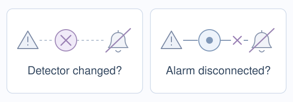
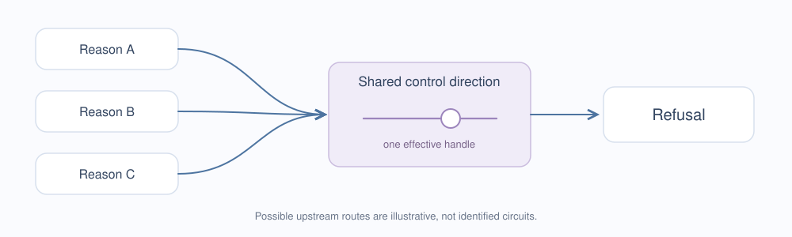
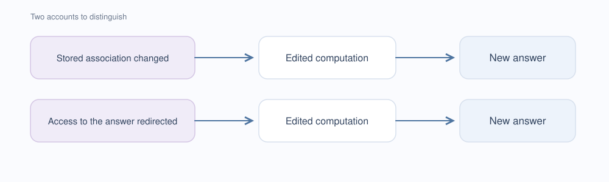
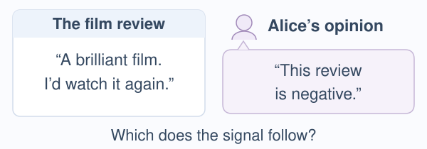
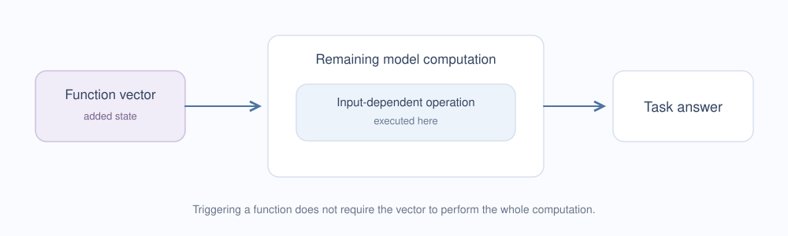

# Where explicit rival questions could sharpen an explanation

Conceptual companion to the Sapphire Bridge use-case page. Prepared from the existing reviewed website analysis on 15 October 2026. The Refusal section distinguishes Arditi's actual causal finding, the semantic question the authors explicitly leave open, and the next explanatory step Causal Decidability organizes. The alarm analogy and Zhao et al.'s follow-up illustrate that step; they do not establish a new research gap. No experiments were conducted.

The website presents two concise stories: Refusal and CCS. This companion retains all five analyses, including Knowledge Neurons, ROME and Function Vectors, with their original section numbering. The illustrations and detailed sources remain available here.

## How to read this analysis

These are proposed applications, not replications, rebuttals or demonstrated counterexamples. Not using causal decidability does not make a conclusion unsupported. The original papers already include controls and limitations. An alternative earns its place only if it is compatible with those checks and can be given distinct, testable predictions.

Each example keeps four things apart: the published finding, the interpretive step, the open alternatives, and what the authors already secure. The illustrations are conceptual, not empirical circuit reconstructions. A competing verbal description is not yet an operational rival.

## 01. Arditi et al. · Refusal direction · NeurIPS 2024

### Original passage and context

> refusal is mediated by a one-dimensional subspace

[Original paper](https://arxiv.org/html/2406.11717) — Abstract and §3; read alongside the Limitations in §7. The paper's central result is a causal mediation finding, not merely that refusal can be changed.

The authors also explicitly state that the:

> semantic meaning of these directions remains unclear

[Discussion and Limitations, §7](https://arxiv.org/html/2406.11717#S7). They allow interpretations involving harm or danger, as well as the possibility that the direction has no straightforward semantic interpretation. The website's follow-up question develops this acknowledged uncertainty.

### What the intervention or measurement establishes

Across 13 chat models, the authors identify one direction per model. Removing its component from the residual stream suppresses refusal and can elicit harmful completions; adding it can induce refusal even on harmless requests. The study evaluates refusal and harmfulness separately. This is evidence for a causal control direction in the tested settings. Removal acts across layers and token positions; addition acts at a selected layer across token positions. A single direction must not be mistaken for a single anatomical site or a complete account of safety.

### The interpretive step and open alternatives

A direction in activation space can strongly control refusal. The next question is what that common handle tells us about the processes that lead the model to refuse.

Different upstream causes of refusal could converge on that direction. That possibility is compatible with mediation by a single direction; it does not refute the observed control effect.

### What the authors already secure

The authors test addition and ablation, evaluate refusal and harmfulness separately, and check effects on other capabilities. They describe an existence result and explicitly leave the direction’s semantic meaning unclear. Appendix L.1 also tests whether the modification merely blocks familiar refusal strings: the modified model can still produce those strings when asked. A proposed alternative must respect these checks.

### Why this illustrates Causal Decidability

The example makes a general methodological transition visible: from identifying a causally effective direction to explaining its function. Arditi establishes more than an unspecified effect. What remains partly open is which account of the direction's role explains the effect.

Distinguishing those accounts is necessary if the aim is to justify a particular functional or semantic explanation. It is not necessary to establish the already measured intervention effect, and it does not require that Causal Decidability be the only possible method. A separating question may also show that the available evidence cannot yet decide.

Causal Decidability makes this next step a systematic procedure: formulate rival explanations compatible with the existing controls, derive their predictions, check whether the proposed tests can separate them, and retain the explanations that the evidence has not excluded. The intended contribution is an explicit route from an acknowledged open question to a bounded decision, not an automatic interpretation of the direction.

Safety is one application of this broader programme. The longer-term aim is to equip models to propose and test explanations of their own behaviour, with verdicts grounded in interventions rather than self-report. Model-assisted rival formulation and self-inspection remain research goals, not capabilities established by this literature example.

The Refusal example does not claim that this distinction is new, that Arditi's result is refuted, or that Causal Decidability has already produced an additional refusal finding. It illustrates the purpose of the method; our own measured case studies are presented separately.

### Follow-up work already asks a separating question

[Zhao et al., *LLMs Encode Harmfulness and Refusal Separately*](https://arxiv.org/abs/2507.11878) (first released in 2025; reviewed here in [version 5](https://arxiv.org/html/2507.11878v5)) directly investigates this distinction. The authors compare harmfulness-related and refusal-related directions. Their reply-inversion task asks whether an instruction could cause harm: an affirmative answer then reports harmfulness rather than willingness to comply. The two steering interventions produce different response patterns. This provides causal evidence for a functional distinction in the tested settings (§3.5).

The paper also examines accepted harmful and refused harmless inputs, multiple templates and models, and positional effects (Appendices E–F). It presents its interpretation as an existence result rather than a complete account of the underlying circuitry (§7).

This follow-up shows why a discriminating question can matter. It is prior work, not an application of our system or evidence of its superiority. A future claim of additional value would have to respect these existing controls and specify a further distinction they leave unresolved. No such experiment is claimed or commissioned here.

### The alarm analogy

A silent alarm does not, by itself, reveal which part of the protection failed. The detector could no longer signal danger; alternatively, detection could persist while its influence on the alarm is interrupted. In a model, this illustrates a distinction between a change in danger-related processing and a change in how that processing affects the response. The picture identifies neither a literal detector-and-alarm architecture nor an exhaustive set of mechanisms. Zhao et al. already investigate the related harmfulness/refusal distinction; the analogy is not a claim that the literature has overlooked it. Mixed or other explanations may also be needed.

The authors themselves acknowledge that the direction's semantic meaning remains unclear: it could relate to harm or danger, or resist a simple semantic interpretation. This proposed question develops an acknowledged limitation; it does not refute their demonstrated intervention effect. See the [Discussion and Limitations](https://arxiv.org/html/2406.11717#S7).

### Why this matters for bypasses and protection

Different failures can produce the same visible outcome: the model answers a request it previously refused. Identifying whether danger-related processing has changed, or whether its influence on the response has been interrupted, could make the failure more specific. In principle, that knowledge could support both more targeted bypasses and better-targeted safeguards. A protection intended to restore detection would address a different failure from one intended to restore the connection between detection and response.

This is a potential application, not a demonstrated result of our method. The paper already demonstrates refusal bypass through interventions on model internals; this does not establish that the proposed distinction yields a new prompt-based bypass or a robust defense. Access to internal states or weights is different from access through prompts alone, and findings need not transfer to untested models.

### What the method makes explicit

A declared explanation must supply predictions for the chosen interventions and readouts. The method asks which pairs of explanations those predictions distinguish and which remain indistinguishable. It also checks whether the measurement and intervention support the intended interpretation: merely decoding a signal does not establish that it controlled the original answer. Refusal language and actual harmful compliance must remain separate outcomes, as they are in Arditi's paper.

The intended result is an evidence-bounded set of remaining explanations, including unresolved or mixed accounts when appropriate. This is the programme illustrated by the example, not a new experiment plan or a claim that Zhao failed to ask a discriminating question.

### Earlier conceptual picture

The earlier diagram captures a related possibility: different upstream causes may share a control direction. It is retained for context, not presented as an identified circuit or as an exhaustive alternative bank.

## 02. Meng et al. · ROME · NeurIPS 2022

### Original passage and context

> would demonstrate fine-grained understanding of the association-storage mechanisms.

[Original paper](https://arxiv.org/html/2202.05262v5) — §3, before §3.1. This is a short excerpt, not a substitute for its surrounding argument and limitations.

### What the intervention or measurement establishes

ROME combines causal tracing with targeted weight edits. Edited associations generalize across paraphrases while tests assess specificity to related facts.

### The interpretive step and open alternatives

A targeted weight edit changes a factual answer. How far does that success identify the way the original association was stored and retrieved?

Changing a successful route to the answer need not identify the entire native storage-and-retrieval process. A storage account and an access or routing account would need concrete, distinct predictions.

### What the authors already secure

The paper already uses causal tracing, path-specific analyses, paraphrase generalization and neighbourhood specificity. It does not rely on one changed completion alone.

### What an explicit rival check would add

Write down the storage and access accounts on the same intervention menu. Preserve the paper’s generalization and specificity controls; add a test only if the accounts predict a resolvable difference.

A generic “routing” story is not yet a rival. It must be specified and checked against the existing evidence before a separating experiment is meaningful.

Related work already examines the connection between localization and successful editing: [Hase et al., Does Localization Inform Editing?](https://arxiv.org/html/2301.04213)

### Illustration

Conceptual alternatives, not a claim that both reproduce the published experiments.

## 03. Dai et al. · Knowledge neurons · ACL 2022

### Original passage and context

> a promising way to erase undesired knowledge with minimal efforts.

[Original paper](https://aclanthology.org/2022.acl-long.581.pdf#page=8) — §5.2, Erasing Relations · p. 8500. This is a short excerpt, not a substitute for its surrounding argument and limitations.

### What the intervention or measurement establishes

Zeroing selected feed-forward value slots raises perplexity for targeted relations while other tested relations remain comparatively stable.

### The interpretive step and open alternatives

After an intervention, a model no longer retrieves a fact as before. Has the knowledge been removed, or has a particular route to expressing it been disrupted?

This establishes a change in tested knowledge expression. Erasure, restricted accessibility and disrupted output selection need not make the same predictions on other ways of using that information.

### What the authors already secure

The authors compare targeted and other relations, call the case studies preliminary, and explicitly note the limits of cloze tasks and the open question of more general knowledge use.

### What an explicit rival check would add

Specify what each account predicts across direct recall, alternate formulations and indirect use. A lack of recall is informative only relative to a stated test and resolution.

The paper itself acknowledges part of this boundary. The proposed contribution is to make the remaining alternatives and decision conditions explicit.

### Illustration

A metaphor for the distinction. Neither drawer is a literal model component.

## 04. Burns et al. · Contrast-Consistent Search · ICLR 2023

### Original passage and context

> consistency properties that few other features in a language model are likely to satisfy.

[Original paper](https://arxiv.org/html/2212.03827) — §2.2, Method: Contrast-Consistent Search. This is a short excerpt, not a substitute for its surrounding argument and limitations.

### What the intervention or measurement establishes

CCS learns a probe from unlabeled activations using consistency constraints and achieves useful accuracy on tested tasks. For a question with two candidate answers, it examines the internal states of both completed inputs and learns a confident, complementary readout. It does not receive the correct training answers. The paper evaluates answer accuracy, transfer across tasks, and robustness to misleading contexts; its evidence goes beyond consistency alone.

### The film review and Alice's opinion

The website uses an invented, simplified example inspired by Farquhar et al.'s follow-up, not a verbatim experimental stimulus:

- Review: “A brilliant film. I'd watch it again.”
- Alice's stated opinion: “This review is negative.”

The target is whether the review is positive, not whether the film is objectively good. A probe might track the review's sentiment, or the opinion attributed to Alice. When Alice agrees with the review, the predictions coincide. When she disagrees, the same readout can be assessed against two different targets.

[Farquhar et al., *Challenges with Unsupervised LLM Knowledge Discovery*](https://arxiv.org/html/2312.10029) (preprint, December 2023), §4.2 and Appendix C.2, demonstrate this failure in constructed opinion-distractor settings. Their prompts introduce Alice as an authority, and the strength of the distractor needed varies by model. They evaluate both review-label accuracy and agreement with Alice, rather than inferring the probe's meaning from consistency alone. Section 4.3 also tests an implicit character opinion. These are actual follow-up results, not findings of Causal Decidability, and they do not establish that every CCS probe tracks opinions.

### The interpretive step and open alternatives

A readout treats a statement and its negation consistently. What additional evidence tells us which semantic property that readout tracks?

Logical consistency restricts possible readouts, but does not by itself uniquely identify their meaning. Truth, reported belief or another correlated property require distinguishing cases.

### What the authors already secure

The authors test transfer across tasks and sensitivity to misleading contexts, and discuss what the learned signal represents. The identifiability issue is also addressed by subsequent research.

They explicitly state that active lying or deception was not evaluated (§5.1). Learning the probe without labelled training answers is also distinct from identifying the truth orientation without labels: the reported evaluation chooses the better of the two possible label orientations (§2.2). Thus the website describes a useful answer predictor, not an established general-purpose lie detector.

### What an explicit rival check would add

Make the competing interpretations and their predictions explicit before evaluating fresh examples:

| Review sentiment | Alice's stated judgement | Review-tracking account predicts | Opinion-tracking account predicts |
| --- | --- | --- | --- |
| Positive | Positive | Positive | Positive |
| Positive | Negative | Positive | Negative |
| Negative | Positive | Negative | Positive |
| Negative | Negative | Negative | Negative |

The two disagreement rows distinguish these accounts. The agreement rows alone cannot. A conceptual application would keep the trained probe and its label orientation fixed, vary sentiment and attributed opinion independently, and use fresh review families and controlled paraphrases. Check that the edit changes the attributed opinion without changing the review's sentiment or the question being answered. Define an exclusion rule and its uncertainty before evaluation. Surface-word accounts would need additional separating cases; this two-account table is not exhaustive.

Retain every account compatible with the evidence. A mixed response, an invalid comparison, or insufficient precision must not be forced into a semantic label. An outcome could support review-tracking relative to opinion-tracking, favour the latter, or leave both inadequate or unresolved.

This first tests the semantic interpretation of a probe. It does not establish that the signal naturally causes the model's answer. That stronger question requires separately validated interventions and controls for alternative causal routes. The table is a conceptual illustration, not a frozen experiment plan or an experiment performed here.

The intended contribution is a reusable procedure connecting explicit rivals, separability checks, valid tests and bounded decisions. Farquhar et al. already ask a closely related separating question. Priority for that distinction, or superiority over existing methods, is not claimed; additional value would need to be demonstrated in a fair comparison.

### Newer research relevant to this question

- **Schouten and Bloem (November 2025), [*LLM Probing with Contrastive Eigenproblems: Improving Understanding and Applicability of CCS*](https://arxiv.org/html/2511.02089), §§4.2–4.4.** They reformulate contrastive probing as an eigenproblem, recover performance similar to CCS without its random-initialization sensitivity, and expose multiple candidate directions. In their COPA analysis, extreme examples suggest that the leading direction tracks the positive or negative character of events rather than answer correctness; a second direction predicts correctness with 70% accuracy. They also jointly examine truth and negation. This directly addresses ambiguity about the feature recovered by a contrastive probe. The semantic interpretation of a direction remains something to test; eigenvalue separation alone does not establish its meaning or natural causal role.
- **Sadiekh, Ericheva and Agarwal (AAAI 2026), [*Polarity-Aware Probing for Quantifying Latent Alignment in Language Models*](https://ojs.aaai.org/index.php/AAAI/article/view/41126); [full text](https://arxiv.org/html/2511.21737), §4 and Appendix A.5.** PA-CCS evaluates consistency across opposing harmful/safe statements and alternative formulations in 16 models. Controls replace negation with meaningless markers and examine multiple replacements. These controls add evidence about sensitivity to linguistic polarity. Our methodological reading is narrower than treating such scores as a complete alignment assessment: changes under marker substitution alone do not eliminate every lexical or distribution-shift account, and representational consistency does not by itself establish effective safety behaviour or a natural causal mechanism. This is a possible further question, not a demonstrated defect in their method.

Together these works make CCS a concrete illustration of an active research problem, not an untouched gap. The broader Causal Decidability programme concerns how interpretations are distinguished across applications; alignment is one possible use.

### Illustration

Invented example inspired by the published opinion-distractor tests. The diagram contains no model scores. The [earlier abstract illustration](assets/consistency.svg) is retained as a schematic, not an empirical result.

## 05. Todd et al. · Function vectors · ICLR 2024

### Original passage and context

> Instead they directly represent and trigger nonlinear execution of abstract functions.

[Original paper](https://arxiv.org/html/2310.15213) — Appendix A, Function Vectors Therefore Represent Functions. This is a short excerpt, not a substitute for its surrounding argument and limitations.

### What the intervention or measurement establishes

The intervention induces task behaviour. The paper tests simple token-offset and output-distribution explanations and finds evidence for nonlinear, input-dependent execution.

### The interpretive step and open alternatives

Adding a compact state can make a model perform a task. The next question is which functional interpretation remains stable across changes of input and context.

Any further rival must survive those tests. The useful question is how far a stable functional interpretation extends beyond the tested contexts, not whether a “task switch” trivially contradicts the authors.

### What the authors already secure

The authors examine cyclic mappings, output-distribution reconstructions, layer effects and prompt variation. They explicitly describe vectors as references that trigger functions.

### What an explicit rival check would add

Propose a concrete functional rule and a context-dependent alternative. Derive a case where their outputs diverge; if no compatible separating case exists, do not advertise a challenge.

This is the strongest reminder that naming an alternative is not enough: its compatibility and its discriminating predictions must first be established.

### Illustration

Conceptual diagram consistent with a vector acting as a reference to a function. The vector need not perform the whole computation itself.

## A later application: monitoring

Imagine two agents making the same request. One has permission; the other only says it does. A monitoring test should separate actual authorization from the claim of authorization, then check which one the monitor follows.

The same method question transfers: which alternatives does this test distinguish? Monitoring still needs its own evidence about false alarms, misses, distribution shifts and effective enforcement. This remains a planned application, not a capability established by the Gemma case.

## What this page does and does not contribute

The contribution is a set of concrete questions worth operationalizing. It does not establish that the papers' strongest interpretations are false, that the proposed rivals reproduce the full evidence, or that this method would necessarily reject the original accounts. An honest outcome could strengthen an interpretation, narrow it, or leave an alias group unresolved.

The harmfulness/refusal distinction, the CCS identifiability discussion and the distinction between localization and editing already have relevant prior work, linked above. These examples illustrate the value of discriminating questions; they do not establish priority or superiority for our method. The function-vector example is deliberately demanding: a candidate alternative must survive the authors' existing tests, including their treatment of vectors as function references. The absence of a viable separating case would itself prevent advertising a challenge.

## Sources and local evidence

The source locators were checked for the original site presentation on 15 October 2026. Arditi et al.'s intervention findings, separate refusal/harmfulness evaluation, and Discussion/Limitations were rechecked during the subsequent alarm-analogy discussion. Zhao et al.'s version 5, including §3.5, Appendices E–F and the stated limitations, was read in the accompanying conceptual review and is linked above. The other four papers were also checked against their original text: ROME §§2–3, Knowledge Neurons §§5.2 and 7, CCS §§2.2, 3 and 5.1, and Function Vectors' introduction, Discussion and Appendix A. The Hase and Farquhar follow-up papers were also consulted. The subsequent CCS discussion checked Farquhar's explicit and implicit opinion tests, Schouten and Bloem's §§4.2–4.4, and PA-CCS's setup and marker controls against the primary texts linked above; the AAAI proceedings confirm PA-CCS's 2026 publication. This was a conceptual source review, not a reproduction or empirical audit of their experiments.

- [Earlier source-location index](SOURCES.md).
- [Gemma technical companion](../method/evidence/TECHNICAL_NOTE.md): a measured development case, separate from these conceptual proposals.
- [Gemma exploratory comparison report](../method/evidence/REPORT.md).

This Markdown file can be viewed on GitHub with its relative image links when the `assets/` directory is kept alongside it. The original illustration assets are preserved. The website uses shorter versions of those diagrams for legibility at small widths.
